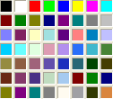
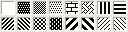
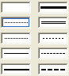

# Формат moxcel (*.mxl), по версии 1.11 бета от 25.03.2004

Данный документ доступен по следующим адресам:\
<http://sourceforge.net/projects/lproject>\
<http://1l.w4b.ru/>\
Авторство принадлежит:\
Copyright © 2004 Дмитрий Павлюк \<dmp@myrealbox.com\>\
Copyright © 2004 Евгений Пивнев \<eugene@spb.rosgazservice.com\>\
Copyright © 2026 Виталий Липатов — перевод в Markdown для GComp 3, исправления опечаток и ссылок

Каждый имеет право воспроизводить, распространять и/или вносить изменения в настоящий документ в соответствии с условиями GNU Free Documentation License, версией 1.2 или любой более поздней версией, опубликованной Free Software Foundation;

Данный документ не содержит неизменяемых разделов, текста, помещаемого на первой странице обложки, и текста, помещаемого на последней странице обложки.

Копия GNU Free Documentation License помещена в файл [licenses/gnu_fdl.html](licenses/gnu_fdl.html).

## Содержание

- [Благодарности](#благодарности)
- [1. Введение](#введениекомментарии)
- [2. Структура файла](#структура-файла)
- [3. Заголовок файла](#заголовок-файла)
- [4. Свойства ячеек (общие)](#свойства-ячейки-общие-св-ва)
  - [4.1. Свойства ячеек по группам (вкладкам)](#свойства-ячейки-по-группам)
  - [4.2. Рисунки цвета](#рисунки-цвета)
  - [4.3. Рисунки узора](#рисунки-узора)
  - [4.4. Рисунки стилей рамки](#рисунки-стилей-рамки)
  - [4.5. Свойства таблицы (отличия)](#изменения-для-свойств-таблицы)
  - [4.6. Свойства колонтитулов (отличия)](#изменения-для-свойств-колонтитулов)
  - [4.7. Свойства ячейки для колонок (отличия)](#изменения-для-свойств-колонки)
  - [4.8. Свойства ячейки для строк (отличия)](#изменения-для-свойств-строки)
  - [4.9. Свойства ячейки для рисунков](#изменения-для-свойств-ячейки-рисунка)
  - [4.10. Свойства рисунка - дополнение к св-вам ячейки](#свойства-рисунка-дополнительные)
    - [+Рисунок](#свойства-рисунка-рисунок)
    - [+OLE](#свойства-рисунка-ole)
  - [4.11. Свойства ячейки для диалога (формы)](#свойства-ячейки-модифицированные-для-диалога)
- [5. Свойства шрифта](#свойства-шрифта)
- [6. Свойства объединения](#свойства-объединения)
- [7. Свойства секции](#свойства-секции)
- [8. Свойства имен](#свойства-имен)

## История

- 2004 — «Moxcel (версия 1.11 бета от 25.03.2004)», авторы Дмитрий Павлюк и Евгений Пивнев, HTML для проекта 1L (http://sourceforge.net/projects/lproject); входил в документацию GComp 2.2.15.
- 2026 — переведён в Markdown для GComp 3 (Виталий Липатов): таблицы без оформления, ссылки на якоря заголовков, к документу присоединена таблица цветов из `colours.html` и `colours.txt`, исправлены опечатки, ссылки на локальный диск автора и на рисунок `mxl_bgc.png`.

------------------------------------------------------------------------

## Благодарности

Большое спасибо:\
**Дмитрию Серёжину \<dm88@bk.ru\>**, ICQ - 36513822 - начавшему разбор формата, и предоставивший, начальные данные по формату (\*.mxl).\
**Евгению Пивневу \<eugene@spb.rosgazservice.com\>** - активно участвовавшему в разборе формата (\*.mxl), и его тестировании.

------------------------------------------------------------------------

## Введение/Комментарии

1.  Файлы типа \*.mxl или "moxcel" представляют собой набор последовательных блоков. Т.е. при разборе файла всегда известна структура текущего блока и какой следующий блок, после текущего. Размер блока может увеличиваться в зависимости от содержимого блока, т.к. может содержать вложенные блоки.
2.  Что такое блок? В принципе их два типа  - "логический" и "физический". Логический блок - это собрание физических блоков в логически целый объект, а физический - это данные, длина которых всегда известна и не меняется. :)
3.  Как правило физический блок устроен так:
    - "количество данных" - число которое указывает, сколько порций данных будет далее;
    - "данные" - данные заданной длины или блоки известной структуры, которые идут друг за другом.

    Т. е.  длина блока не постоянна, а зависит от количества данных которые в нее входят, и если в нее входят другие блоки, то и от их длины.
4.  Логический блок чаще всего устроен так:
    - блок номеров
    - блок свойств

    Например:\
    блок номеров - \[кол-во номеров\] \[номер 1\] \[номер 2\] ... \[номер n\]\
    блок свойств - \[кол-во св-в\] \[св-во 1\] \[св-во 2\] ... \[св-во m\]\
    (!) Важно, как правило n = m, т.к. если сначала идут номера свойств, то их и должно быть столько же, сколько и свойств, справедливо и обратное. :-)\
    И пример их физической реализации:

    | данные         | длина | комментарий                  |
    |----------------|-------|------------------------------|
    | 0x0003         | 2     | кол-во номеров = 3           |
    | 0x00000001     | 4     | первое св-во имеет номер = 1 |
    | 0x00000005     | 4     | второе св-во имеет номер = 5 |
    | 0x00000006     | 4     | и т.д.                       |
    | 0x0003         | 2     | кол-во св-в = 3              |
    | 0x000000000066 | 6     | св-во № 1                    |
    | 0x000000005500 | 6     | св-во № 5                    |
    | 0x007700005500 | 6     | и т.п.                       |
5.  Наиболее распространенным блоком являются св-ва ячейки. Его формат с небольшими изменениями используется для следующих св-в:\
    - общие св-ва таблицы;
    - св-ва колонтитулов;
    - св-ва колонок;
    - св-ва строк;
    - св-ва ячейки; :)
    - св-ва рисунка (OLE, диаграммы);
    - св-ва ячейки диалоговой таблицы.\
6.  Что такое диалоговая таблица?\
    "Диалоговая таблица" - это таблица которая работает в режиме ввода данных. Т.е. это естественно или в отчете, или в обработке в "св-вах формы" выбрана таблица "для ввода данных". После чего в св-вах ячейки появляется дополнительная вкладка "Данные".
7.  Свойства ячейки всегда состоят и пары значений флажок и значение. Если значение флажка не ноль, то сопутствующее ему значение установленно и имеет смысл, Если флажок не установлен, то сопутствующее ему значение либо ноль, либо сохраняет прошлое значение. Флажки являются битовыми. т. е. в одном байте - 8 бит - 8 флажков.\
    В таблице ["свойств ячеек по группам"](#свойства-ячейки-по-группам) отображены вышеупомянутые пары.
8.  Некоторые выводы:\
    - Весь файл можно прочитать только зная всю структуру файла, т.е. расшифровку всех блоков.
    - В файл записываются только измененные значения.
9.  То что не сохраняется в таблице:\
    - "Область печати"
    - "Повторять на каждом листе"
    - "Параметры страницы"
10. Что необходимо еще сделать:\
    - Много непонятных значений в рисунках и OLE.
    - Рисунки к св-вам рисунков
    - ...

------------------------------------------------------------------------

## Структура файла

Краткое описание колонок:\
3 - Обязательная длина, которая есть всегда.\
4,5 - Длина первого, второго уровня, есть только тогда, когда в вышестоящем уровне указано длина больше нуля, и повторяется столько раз, сколько указано в длине.\
Если в длине указан "+" значит длина заранее неизвестна, нужно смотреть свойства текущего блока.

| **1** | **2** | **3** | **4** | **5** | **6** |
|----|----|----|----|----|----|
| **логические блоки** | **физические блоки** | **дл. обяз.** | **дл. ур. 1** | **дл. ур. 2** | **комментарии** |
| **заголовок** |  | 25 (0x19) |  |  | [заголовок](#заголовок-файла) |
| **таблица** | св-ва ячейки для все таблицы | 30 |  |  | [св-ва ячейки для табл.](#изменения-для-свойств-таблицы) |
| **шрифты** | номера шрифтов | 2 |  |  | кол-во |
|  |  |  | 4 |  | номер шрифта |
|  | шрифты | 2 |  |  | кол-во = предедущ. |
|  |  |  | 60 |  | [св-ва шрифта](#свойства-шрифта) |
|  | (?) | 4 |  |  | (?) |
| **колонтитулы** | верхний колонтитул | 30 |  |  | [св-ва ячейки для колонт.](#изменения-для-свойств-колонтитулов) |
|  | нижний колонтитул | 30 |  |  | [св-ва ячейки для колонт.](#изменения-для-свойств-колонтитулов) |
| **колонки** | номера колонок | 2 |  |  | кол-во |
|  |  |  | 4 |  | номер колонки |
|  | колонки | 2 |  |  | кол-во = предедущ. |
|  |  |  | 30 |  | [св-ва ячейки для кол.](#изменения-для-свойств-колонки) |
| **строки** | номера строк | 2 |  |  | кол-во |
|  |  |  | 4 |  | номер строки |
|  | строки | 2 |  |  | кол-во = предедущ. |
|  |  |  | 30 |  | [св-ва ячейки для стр.](#изменения-для-свойств-строки) |
| **ячейки** | номера колонок |  | 2 |  | кол-во |
|  |  |  |  | 4 | номер колонки |
|  | ячейки |  | 2 |  | кол-во = предедущ. |
|  |  |  |  | 30+ | [св-ва ячейки](#свойства-ячейки-общие-св-ва) |
|  | текст |  |  | \+ | текст |
|  | расшифровка |  |  | \+ | расшифровка |
| **рисунки** | рисунки вставляемые | 2 |  |  | кол-во |
|  |  |  | 30+ |  | [св-ва ячейки для рис.](#изменения-для-свойств-ячейки-рисунка) |
|  |  |  | 40 |  | [св-ва рисунка](#свойства-рисунка-дополнительные) |
|  |  |  | \+ |  | [рисунок](#свойства-рисунка-рисунок), [OLE](#свойства-рисунка-ole) |
| **объединение** | объединение | 2 |  |  | кол-во |
|  |  |  | 16 |  | [св-ва объединения](#свойства-объединения) |
| **секции** | секции вертикальные | 2 |  |  | кол-во |
|  |  |  | 13+ |  | [св-ва секции](#свойства-секции) |
|  |  |  | \+ |  | имя |
|  | секции горизонтальные | 2 |  |  | кол-во |
|  |  |  | 13+ |  | [св-ва секции](#свойства-секции) |
|  |  |  | \+ |  | имя |
| **переводы страниц** | переводы страниц вертикальные | 2 |  |  | кол-во |
|  |  |  | 4 |  | номера колонок после |
|  | переводы страниц горизонтальные | 2 |  |  | кол-во |
|  |  |  | 4 |  | номера строк после |
| **имена** | имена | 4 |  |  | кол-во |
|  |  |  | 1 |  | длина имени |
|  |  |  | \+ |  | имя |
|  |  |  | 28 |  | [св-ва имени](#свойства-имен) |

------------------------------------------------------------------------

## Заголовок файла

| Смещение | Длина | Знач. | Комментарий |
|----|----|----|----|
| 0x00 | 6 |  | "MOXCEL" |
| 0x0b |  | 0x06 | ? |
| 0x0d | 4 | 0- | Номер максимальной колонки |
| 0x11 | 4 | 0- | Номер максимальной строки |
| 0x15 | 4 | 0- | Количество рисунков (объектов) или последний номер объекта |

------------------------------------------------------------------------

## Свойства ячейки (общие св-ва)

Флажки:\
    - (изменение) устанавливает если хоть раз св-во изменилось и больше не сбрасывается.\
    - (не авто) если значение установить в "Авто", флажок сбрасывается,\
      а сопутствующие значения (цветов) остаются, т. е. флажок может быть сброшен = 0,\
      но значение (цвета) быть не нулевым, ведь 0 = первый цвет (черный).\
    - (длина \> 0) если длина строки = 0, флажок сбрасывается.

| Смещение | Длина | Знач. | Комментарий | По умолч. |
|----|----|----|----|----|
|  |  |  | **Флажки** |  |
| 0x00 | 1 | 0x01 0x02 0x04 0x08 0x10 0x20 0x40 0x80 | [Шрифт - Имя](#свойства-ячейки-общие-св-ва) (не авто) [Шрифт - Размер](#свойства-ячейки-общие-св-ва) (не авто) [Шрифт - Жирный](#свойства-ячейки-общие-св-ва) (изменение) [Шрифт - Наклонный](#свойства-ячейки-общие-св-ва) (изменение) [Шрифт - Подчеркнутый](#свойства-ячейки-общие-св-ва) (изменение) [Рамка - Лево](#свойства-ячейки-общие-св-ва) (изменение) [Рамка - Верх](#свойства-ячейки-общие-св-ва) (изменение) [Рамка - Право](#свойства-ячейки-общие-св-ва) (изменение) | 0 |
| 0x01 | 1 | 0x01 0x02 0x04 0x08 0x10  0x20 0x40 0x80 | [Рамка - Низ](#свойства-ячейки-общие-св-ва) (изменение) [Цвет рамок](#свойства-ячейки-общие-св-ва) (не авто) Флажок общий № 1 (исп. в других св-вах) Флажок общий № 2 (исп. в других св-вах) [По горизонтали](#свойства-ячейки-общие-св-ва) (изменение) [По выделенным столбцам](#свойства-ячейки-общие-св-ва) (изменение) [По вертикали](#свойства-ячейки-общие-св-ва) (изменение) [Цвет шрифта](#свойства-ячейки-общие-св-ва) (не авто) [Фон](#свойства-ячейки-общие-св-ва) (не авто) | 0 |
| 0x02 | 1 | 0x01 0x02 0x04 0x08 0x10 | [Узор](#свойства-ячейки-общие-св-ва) (не авто) [Цвет узора](#свойства-ячейки-общие-св-ва) (не авто) [Контроль](#свойства-ячейки-общие-св-ва) (изменение) [Тип](#свойства-ячейки-общие-св-ва) (изменение) [Защита](#свойства-ячейки-общие-св-ва) (изменение) | 0 |
| 0x03 | 1 | 0x40 0x80 | [Расшифровка](#свойства-ячейки-общие-св-ва) (длина \> 0) [Текст](#свойства-ячейки-общие-св-ва) (длина \> 0) | 0 |
|  |  |  | **Значения** |  |
| 0x04 | 2 |  | Значение общие № 1 (исп. в других св-вах) |  |
| 0x06 | 2 |  | Значение общие № 2 (исп. в других св-вах) |  |
| 0x08 | 2(?) | 1- | Номер Имени шрифта | = Arial (задается в конфигураторе) |
| 0x0a | 2 | р | Шрифт - Размер 8=-32, 9=-36, 10=-40, 11=-44 размер = -р/4 | = 8 (задается в конфигураторе) |
| 0x0c | 1 | 4 7 | Шрифт - Жирный = 0 Шрифт - Жирный = 1 | 0 |
| 0x0d | 1 | 0 1 | Шрифт - Наклонный = 0 Шрифт - Наклонный = 1 | 0 |
| 0x0e | 1 | 0 1 | Шрифт - Подчеркнутый = 0 Шрифт - Подчеркнутый = 1 | 0 |
| 0x0f | 1 | 0 2 4 6 0x20 | По горизонтали = Лево По горизонтали = Право По горизонтали = По ширине По горизонтали = Центр По выделенным столбцам = 1 | По горизонтали = Лево, По выделенным столбцам = 0 |
| 0x10 | 1 | 0 0x08 0x18 | По вертикали = Верх По вертикали = Низ По вертикали = Центр | = Низ |
| 0x11 | 1 | 0-15 | [Узор](#рисунки-узора) = Номер узора (отсчет слева - направо, сверху - вниз) При "Авто" сохраняет номер старого номера | = Авто |
| 0x12 | 1 | 0-9 | [Рамка - Лево](#рисунки-стилей-рамки) = Номер стиля рамки (отсчет особый) | 0 |
| 0x13 | 1 | 0-9 | [Рамка - Верх](#рисунки-стилей-рамки) = Номер стиля рамки (отсчет особый) | 0 |
| 0x14 | 1 | 0-9 | [Рамка - Право](#рисунки-стилей-рамки) = Номер стиля рамки (отсчет особый) | 0 |
| 0x15 | 1 | 0-9 | [Рамка - Низ](#рисунки-стилей-рамки) = Номер стиля рамки (отсчет особый) | 0 |
| 0x16 | 1 | 0-55 | [Цвет узора](#рисунки-цвета) = Номер цвета (отсчет слева - направо, сверху - вниз) | = Авто |
| 0x17 | 1 | 0-55 | [Цвет рамок](#рисунки-цвета) = Номер цвета (отсчет слева - направо, сверху - вниз) | = Авто |
| 0x18 | 1 | 0-55 | [Цвет шрифта](#рисунки-цвета) = Номер цвета (отсчет слева - направо, сверху - вниз) | = Авто |
| 0x19 | 1 | 0-55 | [Фон](#рисунки-цвета) = Номер цвета [(отсчет слева - направо, сверху - вниз)](images/mxl_bgc.png) | = Авто |
| 0x1a | 1 | 0 1 2 3 4 5 | Контроль = Авто Контроль = Обрезать Контроль = Забивать Контроль = Переносить Контроль = Красный Контроль = Забивать + Красный | = Авто |
| 0x1b | 1 | 0 1 2 3 | Тип = Текст Тип = Выражение Тип = Шаблон Тип = Фикс. шаблон | = Текст |
| 0x1c | 1 | 1 | Защита = 0, т. е. инверсия! | = 1 (0) |
| 0x1d |  |  | ? |  |
|  |  |  | **Блок Текста** |  |
| 0x00 0x00+ 0x01 | 1(\*) 2(\*\*) дл1 | дл1(1) дл1(2) | Длина Текста (?(\<255, дл, 0xff)) Длина Текста (?(\>=255, дл, "")) Текст | = "" (Нет) |
|  |  |  | **Блок Расшифровки** |  |
| 0x00 0x00+ 0x01 | 1(\*) 2(\*\*) дл2 | дл2(1) дл2(2) | Длина Расшифровки (?(\<255, дл, 0xff)) Длина Расшифровки (?(\>=255, дл, "")) Расшифровка | = "" (Нет) |
|  |  |  | \* - Блок Текста и Расшифровки, вставляются после блока Ячейки, только в том случае, если длина строки их текста больше нуля. И в порядке приведенном в таблице - Текст, Расшифровка. \*\* - если длина текста больше 254, то она записывается 3 байтами, первый - 0xff, далее идет слово - длина текста. |  |

------------------------------------------------------------------------

## Свойства ячейки по группам

| **Группа** | **Название значения** | **Смещ. флага** | **Знач. флага** | **Смещ. знач.** |
|----|----|----|----|----|
| **Текст** |  |  |  |  |
|  | Тип | [0x02](#свойства-ячейки-общие-св-ва) | 0x08 | [0x1b](#свойства-ячейки-общие-св-ва) |
|  | Контроль | [0x02](#свойства-ячейки-общие-св-ва) | 0x04 | [0x1a](#свойства-ячейки-общие-св-ва) |
|  | Текст (Значение) | [0x03](#свойства-ячейки-общие-св-ва) | 0x80 | [0x1d+](#свойства-ячейки-общие-св-ва) |
|  | Расшифровка | [0x03](#свойства-ячейки-общие-св-ва) | 0x40 | [0x1d+](#свойства-ячейки-общие-св-ва) |
|  | Защита | [0x02](#свойства-ячейки-общие-св-ва) | 0x10 | [0x1c](#свойства-ячейки-общие-св-ва) |
| **Положение** |  |  |  |  |
|  | По горизонтали | [0x01](#свойства-ячейки-общие-св-ва) | 0x10 | [0x0f](#свойства-ячейки-общие-св-ва) |
|  | По выделенным столбцам | [0x01](#свойства-ячейки-общие-св-ва) | 0x10 | [0x0f](#свойства-ячейки-общие-св-ва) |
|  | По вертикали | [0x01](#свойства-ячейки-общие-св-ва) | 0x20 | [0x10](#свойства-ячейки-общие-св-ва) |
| **Шрифт** |  |  |  |  |
|  | Имя | [0x00](#свойства-ячейки-общие-св-ва) | 0x01 | [0x08](#свойства-ячейки-общие-св-ва) |
|  | Размер | [0x00](#свойства-ячейки-общие-св-ва) | 0x02 | [0x0a](#свойства-ячейки-общие-св-ва) |
|  | Жирный | [0x00](#свойства-ячейки-общие-св-ва) | 0x04 | [0x0c](#свойства-ячейки-общие-св-ва) |
|  | Наклонный | [0x00](#свойства-ячейки-общие-св-ва) | 0x08 | [0x0d](#свойства-ячейки-общие-св-ва) |
|  | Подчеркнутый | [0x00](#свойства-ячейки-общие-св-ва) | 0x10 | [0x0e](#свойства-ячейки-общие-св-ва) |
|  | Цвет | [0x01](#свойства-ячейки-общие-св-ва) | 0x40 | [0x18](#свойства-ячейки-общие-св-ва) |
| **Рамка** |  |  |  |  |
|  | Лево | [0x00](#свойства-ячейки-общие-св-ва) | 0x20 | [0x12](#свойства-ячейки-общие-св-ва) |
|  | Верх | [0x00](#свойства-ячейки-общие-св-ва) | 0x40 | [0x13](#свойства-ячейки-общие-св-ва) |
|  | Право | [0x00](#свойства-ячейки-общие-св-ва) | 0x80 | [0x14](#свойства-ячейки-общие-св-ва) |
|  | Низ | [0x01](#свойства-ячейки-общие-св-ва) | 0x01 | [0x15](#свойства-ячейки-общие-св-ва) |
|  | Обвести |  |  |  |
|  | Цвет | [0x01](#свойства-ячейки-общие-св-ва) | 0x02 | [0x17](#свойства-ячейки-общие-св-ва) |
| **Узор** |  |  |  |  |
|  | Фон | [0x01](#свойства-ячейки-общие-св-ва) | 0x80 | [0x19](#свойства-ячейки-общие-св-ва) |
|  | Узор | [0x02](#свойства-ячейки-общие-св-ва) | 0x01 | [0x11](#свойства-ячейки-общие-св-ва) |
|  | Цвет | [0x02](#свойства-ячейки-общие-св-ва) | 0x02 | [0x16](#свойства-ячейки-общие-св-ва) |
| **+ Колонки** |  |  |  |  |
|  | Положение на странице верт. | [0x01](#свойства-ячейки-общие-св-ва) | 0x04 | [0x04](#свойства-ячейки-общие-св-ва) |
|  | Ширина колонки | [0x01](#свойства-ячейки-общие-св-ва) | 0x08 | [0x06](#свойства-ячейки-общие-св-ва) |
| **+ Строки** |  |  |  |  |
|  | Высота строки | [0x01](#свойства-ячейки-общие-св-ва) | 0x04 | [0x04](#свойства-ячейки-общие-св-ва) |
|  | Положение на странице гориз. | [0x01](#свойства-ячейки-общие-св-ва) | 0x08 | [0x06](#свойства-ячейки-общие-св-ва) |
| **+ Колонтитулы** |  |  |  |  |
|  | Выводить с: | [0x01](#свойства-ячейки-общие-св-ва) | 0x04 | [0x04](#свойства-ячейки-общие-св-ва) |
|  | номер страница | [0x01](#свойства-ячейки-общие-св-ва) | 0x08 | [0x06](#свойства-ячейки-общие-св-ва) |

------------------------------------------------------------------------

## Рисунки Цвета

\
(отсчет слева - направо, сверху - вниз)\
([вариант](#таблица-цветов) - сделан при помощи Gimp, достоверность не гарантируется)

------------------------------------------------------------------------

## Рисунки Узора

\
(отсчет слева - направо, сверху - вниз)

------------------------------------------------------------------------

## Рисунки Стилей рамки

Номера стилей по их положению на рисунке:

| Левый столбец | Правый столбец |
| ---: | ---: |
| 0 | 4 |
| 1 | 5 |
| 8 | 6 |
| 2 | 7 |
| 3 | 9 |

(отсчет особый - примерно сверху - вниз, слева - направо)

------------------------------------------------------------------------

## Изменения для свойств таблицы

Отличия от [св-в ячейки](#свойства-ячейки-общие-св-ва)

| **Смещение** | **Длина** | **Знач.** | **Комментарий** | **По умолч.** |
|--------------|-----------|-----------|-----------------|---------------|
| **Флажки**   |           |           |                 |               |
| 0x01         | 1         | 0x08      | ?               | 0x08          |
| **Значение** |           |           |                 |               |
| 0x06         | 2         | 0x0048    | ?               | 0x0048        |

------------------------------------------------------------------------

## Изменения для свойств колонтитулов

Отличия от [св-в ячейки](#свойства-ячейки-общие-св-ва)

| **Смещение** | **Длина** | **Знач.** | **Комментарий** | **По умолч.** |
|----|----|----|----|----|
| **Флажки** |  |  |  |  |
| 0x01 | 1 |  | 0x04 = Выводить с: (изменение) 0x08 = Номер страницы (изменение) |  |
| **Значения** |  |  |  |  |
| 0x04 | 2 |  | Выводить с: 1 = да (отметка галочкой) 0xffff = нет | 1 |
| 0x06 | 2 |  | Выводить с: номер страницы | 1 |

------------------------------------------------------------------------

## Изменения для свойств колонки

Отличия от [св-в ячейки](#свойства-ячейки-общие-св-ва)

| **Смещение** | **Длина** | **Знач.** | **Комментарий** | **По умолч.** |
|----|----|----|----|----|
| **Флажки** |  |  |  |  |
| 0x01 | 1 |  | 0x04 = Положение на странице (изменение) 0x08 = Ширина колонки (не авто) | 0  Авто=0 |
| **Значения** |  |  |  |  |
| 0x04 | 2 |  | Положение на странице верт. 0x01 = с новой строки 0x02 = вместе со следующим (значения могут суммироваться) | 0 |
| 0x06 | 2 | ш | Ширина колонки 30=240, 45=360 ширина = ш/8 (При авто сохр. старое знач.) | Авто=0, (ширина = 9) |

------------------------------------------------------------------------

## Изменения для свойств строки

Отличия от [св-в ячейки](#свойства-ячейки-общие-св-ва)

| **Смещение** | **Длина** | **Знач.** | **Комментарий** | **По умолч.** |
|----|----|----|----|----|
| **Флажки** |  |  |  |  |
| 0x01 | 1 |  | 0x04 = Высота строки (изменение) 0x08 = Положение на странице (изменение) |  |
| **Значения** |  |  |  |  |
| 0x04 | 2 | в | Высота строки 30=120, 60=240 высота = в/4 | Авто=0, (высота=11,25) |
| 0x06 | 2 |  | Положение на странице гориз. 0x01 = с новой строки 0x02 = вместе со следующим (значения могут суммироваться) | 0 |

------------------------------------------------------------------------

## Изменения для свойств ячейки рисунка

Отличия от [св-в ячейки](#свойства-ячейки-общие-св-ва). Изменилась вкладка "Рамка" на "Линия".

| Смещение | Длина | Знач. | Комментарий | По умолч. |
|----|----|----|----|----|
| **Флажки** |  |  |  |  |
| 0x00 | 1 | 0x20 0x40 0x80 | Стиль (изменения) Толщина (изменения) Рамки (изменения) |  |
| 0x01 | 1 | 0xa0 0x01 | По умолчанию (Цвет шрифта=0, фон=1) Выводить на печать (изменения) | 0xa0 |
| 0x02 | 1 | 0x08 | Тип текста (по умолчанию для рисунка, OLE, диаграммы) | 0x08 |
| **Значения** |  |  |  |  |
| 0x12 | 1 | 0-5 | Стиль | Стиль=1 |
| 0x13 | 1 | 0-2 | Толщина | Толщина=0 |
| 0x14 | 1 | 0x01 0x02 0x04 0x08 | Рамки Слева Сверху Справа Снизу | =0x0f |
| 0x15 | 1 | 0-1 | 0 - Выводить на печать 1 - Не выводить на печать (инверсия) | Выводить на печать = 0 |
| 0x1b | 1 | 0x04 | Тип текста = ? (комментарий) (по умолчанию для рисунка, OLE, диаграммы) | 0x04 |

------------------------------------------------------------------------

## Свойства рисунка (дополнительные)

Общие для всех рисунков

| Смещение | Длина | Знач. | Комментарий | По умолч. |
|----|----|----|----|----|
| 0x00 | 4(?) | 1 2 3 4 5 | Объект: Линия Прямоугольник Текст OLE, Диаграмма Рисунок |  |
| 0x04 | 4 | 0- | Номер колонки начальной ячейки |  |
| 0x08 | 4 | 0- | Номер строки начальной ячейки |  |
| 0x0с | 4 | 0- | Смещение X относительно верхнего левого угла начальной ячейки в ? |  |
| 0x10 | 4 | 0- | Смещение Y относительно верхнего левого угла начальной ячейки в ? |  |
| 0x14 | 4 | 0- | Номер колонки конечной ячейки |  |
| 0x18 | 4 | 0- | Номер строки конечной ячейки |  |
| 0x1с | 4 | 0- | Смещение X относительно верхнего левого угла конечной ячейки в ? |  |
| 0x20 | 4 | 0- | Смещение Y относительно верхнего левого угла конечной ячейки в ? |  |
| 0x24 | 4(?) | 1- | Уровень плана (?), связано с командами на передний, задний план |  |

------------------------------------------------------------------------

## Свойства рисунка (рисунок)

Добавляется после дополнительных св-в (только для рисунка)\
Длина 8 байт + рисунок

| Смещение | Длина | Знач.  | Комментарий      | По умолч.  |
|----------|-------|--------|------------------|------------|
| 0x00     | 4     | 0x746с | ? = "lt\x00\x00" | 0x0000746c |
| 0x04     | 4     | дл     |                  |            |
| 0x04+    | дл    |        | Рисунок          |            |

------------------------------------------------------------------------

## Свойства рисунка (OLE)

Добавляется после дополнительных св-в (только OLE, диаграммы)\
Длина 42(для первого)/24(для остальных) байта + OLE

| Смещение | Длина | Знач. | Комментарий | По умолч. |
|----|----|----|----|----|
|  |  |  | **начало** (длина = 2) |  |
| 0x00 | 2 | 0xffff 0x8001 | \- Есть "строка имени OLE" (?) - Нет |  |
|  |  |  | **строка имени OLE** (длина = 4\*+14\*) встречается только в первом OLE |  |
| 0x00+2 | 2(\*) | 0 | (?) \* - Есть, только при 0x00 = 0xffff | 0x00 |
| 0x00+4 | 2(\*) | дл_об | Длина строки OLE (всегда 0x0e) \* - Есть, только при 0x00 = 0xffff | 0x0e |
| 0x00+6 | дл_об(\*) |  | Строка OLE (всегда "CSheetCntrItem") \* - Есть, только при 0x00 = 0xffff | "CSheetCntrItem" |
|  |  |  | **продолжение** (длина = 22) |  |
| 0x00 | 4 | 0x100 | ? = 256 | 0x00000100 |
| 0x02 | 4 |  | Порядковый номер рисунка (?), от рис. к рис. увеличивается на 2 или 3 |  |
| 0x06 | 4 |  | 1 - для OLE 0x0012f150 - для "Диаграммы" |  |
| 0x0a | 2 | 0 | 0 | 0x0000 |
| 0x0e | 4 | 1 | 1 | 0x00000001 |
| 0x12 | 4 | длOLE | Длина OLE объекта |  |
| 0x12+1 | длOLE |  | OLE |  |

------------------------------------------------------------------------

## Свойства ячейки (модифицированные для диалога)

Отличия от [св-в ячейки](#свойства-ячейки-общие-св-ва). Добавилась вкладка "Данные".

| **Смещение** | **Длина** | **Знач.** | **Комментарий** | **По умолч.** |
|----|----|----|----|----|
|  |  |  | **Флажки** |  |
| 0x02 | 1 | 0x20 | Тип (изменения) |  |
| 0x03 | 1 |  | 0x40 = Формула (длина \> 0) 0x80 = Текст (длина \> 0) |  |
|  |  |  | **Значения** |  |
| 0x1d+ | 0+1+дл |  | текст = значение (см. св-ва ячейки)  |  |
| 0x1d+ | 0+1+дл |  | формула (см. св-ва ячейки) |  |
|  |  | **(длина=16+)** | **доп. св-ва** |  |
| 0x00 | 1 | дл_с | Длина всех доп. св-в |  |
| 0x04 | 1 | 0x03 | ? исп. в строке, число |  |
| 0x06 | 1 |  | Тип = 0x41 = Вид расчета 0x42 = Справочник 0x43 = Календарь 0x44 = Дата 0x45 = Перечисление 0x4b = Вид субконто 0x4e = Число 0x4f = Документ 0x50 = План счетов 0x53 = Строка 0x53 = Счет 0x55 = Неопределенный |  |
| 0x07 | 1 | 0- | Длина (строки, числа и т. п.) |  |
| 0x0b | 1 | 0- | Точность (число) |  |
| 0x0f | 2 | 0- | ? Номер вида справочника, документа, перечисления, и т.п. |  |
| 0x13 | 1 | 0x01 | Не отрицательный=1 (число) |  |
| 0x14 | 1 | 0x01 | Разделять триады=1 (число) |  |
| 0x15 | 1(\*) | дл_вз | ? Длина внутреннего значения. \*Есть у числа, даты, справочника, документа, перечисления и т.п. |  |
| 0x15+ | дл_вз |  | ? Внутреннее значение |  |
|  |  | **(длина=1+)** |  |  |
| 0x00 | 1 | дл_ф |  | 0 |
| 0x00+ | дл_ф |  | Формат |  |
|  |  | **(длина=7+)** |  |  |
| 0x00 |  | 0x01 | ? (установленно у неопр. значения) |  |
| 0x01 |  |  |  |  |
| 0x02 | 1 | 0x01 | Кнопка выбора=1 | 0 |
| 0x03 |  |  |  |  |
| 0x04 | 1 | 0x01 | Сделать недоступным=1 | 0 |
| 0x05 | 1 | 0x01 | Запретить редактирование=1 | 0 |
| 0x06 | 1 | дл_м | Длина маски |  |
| 0x06+ | дл_м |  | Маска |  |

------------------------------------------------------------------------

## Свойства шрифта

(см. MFC CFont)

| **Смещение** | **Длина** | **Знач.** | **Комментарий** | **По умолч.** |
|----|----|----|----|----|
| 0x00 | 4 |  | Высота: 0 - По умолчанию \>0 - Размер шрифта \<0 - Абсолютный размер шрифта | 0 |
| 0x04 | 4 |  | Ширина | 0 |
| 0x08 | 4 |  | Escapement | 0 |
| 0x0с | 4 |  | Ориентация | 0 |
| 0x10 | 4 |  | Weight: 0x700 - bold 0x400 - regular | 0 |
| 0x14 | 1 |  | Italic | 0 |
| 0x15 | 1 |  | Underline | 0 |
| 0x16 | 1 |  | StrikeOut | 0 |
| 0x17 | 1 |  | Кодировка: 0xcc (204) - кириллица |  |
| 0x18 | 1 | 3 | OutPrecision: OUT_STROKE_PRECIS = 3 |  |
| 0x19 | 1 | 2 | ClipPrecision: CLIP_STROKE_PRECIS = 2 |  |
| 0x1a | 1 | 1 | Quality: DRAFT_QUALITY = 1 |  |
| 0x1b | 1 |  | PitchAndFamily: DEFAULT_PITCH = 0 FIXED_PITCH = 1 VARIABLE_PITCH = 2 MONO_FONT = 8 и: FF_DONTCARE = 0x00 FF_ROMAN = 0x10 FF_SWISS = 0x20 FF_MODERN = 0x30 FF_SCRIPT = 0x40 FF_DECORATIVE = 0x50 |  |
| 0x1c | 32 |  | Имя шрифта (заканчивается на 0) |  |

------------------------------------------------------------------------

## Свойства объединения

| **Смещение** | **Длина** | **Знач.** | **Комментарий** | **По умолч.** |
|----|----|----|----|----|
| 0x00 | 4 |  | Номер начальной колонки |  |
| 0x04 | 4 |  | Номер конечной строки |  |
| 0x08 | 4 |  | Номер конечной колонки |  |
| 0x0с | 4 |  | Номер конечной строки |  |

------------------------------------------------------------------------

## Свойства секции

| **Смещение** | **Длина** | **Знач.** | **Комментарий** | **По умолч.** |
|----|----|----|----|----|
| 0x00 | 4 |  | Номер начальной строки/колонки |  |
| 0x04 | 4 |  | Номер конечной строки/колонки |  |
| 0x08 | 4(?) |  | Входимость в другую группу = номер верхней группы | 0 |
| 0x0c | 1 | дл | Длина имени секции |  |
| \+ | дл |  | Имя секции |  |

------------------------------------------------------------------------

## Свойства имен

| **Смещение** | **Длина** | **Знач.** | **Комментарий**         | **По умолч.** |
|--------------|-----------|-----------|-------------------------|---------------|
| 0x00         | 1         | дл_и      | Длина имени             |               |
| 0x00+        | дл_и      |           | Имя                     |               |
| 0x00         | 4(?)      | 1         | ?                       |               |
| 0x04         | 4(?)      |           | 0x0012f9e8 (?)          |               |
| 0x08         | 4(?)      | 3         | ?                       |               |
| 0x0c         | 4         |           | номер начальной колонки |               |
| 0x10         | 4         |           | номер начальной строки  |               |
| 0x14         | 4         |           | номер конечной колонки  |               |
| 0x18         | 4         |           | номер конечной строки   |               |

------------------------------------------------------------------------

\(c\) Дмитрий Павлюк\
(с) Евгений Пивнев

------------------------------------------------------------------------

## Таблица цветов

Номера цветов палитры и их значения; сделана при помощи Gimp, достоверность не гарантируется.

| Номер | Цвет | Номер | Цвет | Номер | Цвет | Номер | Цвет |
|---:|---|---:|---|---:|---|---:|---|
| 0 | `#000000` | 1 | `#ffffff` | 2 | `#ff0000` | 3 | `#00ff00` |
| 4 | `#0000ff` | 5 | `#ffff00` | 6 | `#ff00ff` | 7 | `#00ffff` |
| 8 | `#800000` | 9 | `#008000` | 10 | `#808000` | 11 | `#000080` |
| 12 | `#800080` | 13 | `#008080` | 14 | `#808080` | 15 | `#c0c0c0` |
| 16 | `#8080ff` | 17 | `#802060` | 18 | `#ffffc0` | 19 | `#a0e0e0` |
| 20 | `#600080` | 21 | `#ff8080` | 22 | `#0080c0` | 23 | `#c0c0ff` |
| 24 | `#00cfff` | 25 | `#69ffff` | 26 | `#e0ffe0` | 27 | `#dd9cb3` |
| 28 | `#b38fee` | 29 | `#2a6ff9` | 30 | `#3fb8cd` | 31 | `#488436` |
| 32 | `#958c41` | 33 | `#8e5e42` | 34 | `#a0627a` | 35 | `#624fac` |
| 36 | `#1d2fbe` | 37 | `#286676` | 38 | `#004500` | 39 | `#453e01` |
| 40 | `#6a2813` | 41 | `#85396a` | 42 | `#4a3285` | 43 | `#c0dcc0` |
| 44 | `#a6caf0` | 45 | `#800000` | 46 | `#008000` | 47 | `#000080` |
| 48 | `#808000` | 49 | `#800080` | 50 | `#008080` | 51 | `#808080` |
| 52 | `#fffbf0` | 53 | `#a0a0a4` | 54 | `#313900` | 55 | `#d9853e` |
